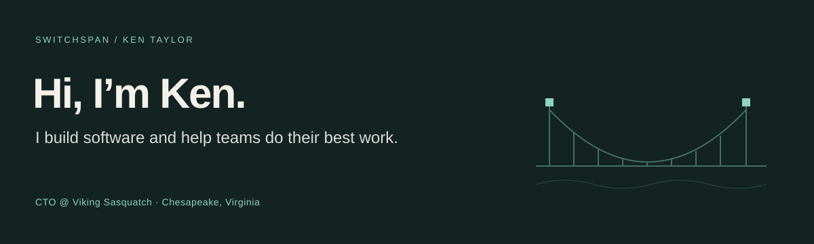

I’m a software builder and engineering leader in Chesapeake, Virginia. At **[Viking Sasquatch](https://vikingsasquatch.com)**, I work on cloud platforms, integrations, and the practices that help teams deliver reliable software.

My career spans 28+ years in software development, architecture, and engineering leadership. These days, that includes exploring where AI-assisted development can help—and keeping people responsible for the results.

**What I work on:** Cloud architecture · API integration · Engineering leadership · AI-assisted development

### A little more about me

- Co-inventor of **U.S. Patent 8,165,939** (2012), a real-estate settlement fraud-detection system launched as **Rynoh Live**.
- Virginia Defense Force volunteer, **2021–2025**.
- Civil Air Patrol volunteer, **2019–2024**.

Here you’ll find some of my projects and interests. If our work overlaps, let’s connect.

[Connect on LinkedIn](https://www.linkedin.com/in/kentaylorlinked/) · [Viking Sasquatch](https://vikingsasquatch.com) · [Browse my repositories](https://github.com/switchspan?tab=repositories)
